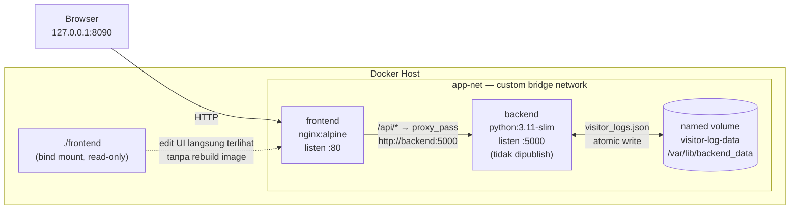
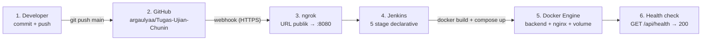

# Log & Hit Counter Pengunjung Web

**UTS Cloud Computing — Studi Kasus 5** (Cloud-Native Fullstack & Automated CI/CD)

| | |
|---|---|
| Institusi | Telkom University |
| Mata Kuliah | Cloud Computing |
| Studi Kasus | #5 — Web Visitor Counter Log |
| Repositori | https://github.com/argaulyaa/Tugas-Ujian-Chunin |

## Anggota Kelompok

| Nama | NIM |
|---|---|
| _isi nama_ | _isi NIM_ |
| _isi nama_ | _isi NIM_ |
| _isi nama_ | _isi NIM_ |
| _isi nama_ | _isi NIM_ |

> Ganti baris di atas dengan nama dan NIM sebenarnya sebelum dikumpulkan.

## Studi Kasus

Sistem pencatat statistik kunjungan halaman web laboratorium: setiap kunjungan ke landing
page dicatat, daftar kunjungan bisa dilihat dan dihapus, dan jumlah hit berkurang saat satu
entri dihapus. Selain endpoint wajib, ada login ringan supaya data kunjungan tidak terbuka
untuk publik.

## Diagram Arsitektur



Alur CI/CD:



## Prasyarat

- Docker Engine 24+ dengan plugin Compose v2 (`docker compose version`)
- Git
- Python 3.11+ (hanya untuk unit test di host; runtime aplikasi ada di dalam Docker)

## Menjalankan di Lokal

```bash
# 1. Siapkan kredensial login (password tidak disimpan, hanya verifier PBKDF2)
python3 setup_account.py                       # interaktif
AUTH_USERNAME=admin AUTH_PASSWORD='...' python3 setup_account.py --from-env   # non-interaktif

# 2. Build dan jalankan seluruh stack
docker compose up -d --build

# 3. Cek kesehatan
curl -s http://127.0.0.1:8090/api/health       # {"status": "ok"}
```

Landing page: `http://127.0.0.1:8090` — dashboard: `http://127.0.0.1:8090/login.html`.

Variabel yang dibaca dari `.env` (contoh lengkap di `.env.example`):

| Variabel | Keterangan |
|---|---|
| `AUTH_USERNAME` | username dashboard |
| `AUTH_SALT` | 32 karakter hex (16 byte acak) |
| `AUTH_PASSWORD_HASH` | PBKDF2-HMAC-SHA256, 600.000 iterasi, hex |
| `FRONTEND_PORT` | port host untuk Nginx (default `8090`) |
| `IMAGE_TAG` | tag image backend yang dipakai Compose (default `dev`) |

## API

| Method | Endpoint | Auth | Keterangan |
|---|---|---|---|
| GET | `/api/health` | – | kesiapan storage (`200` / `503`) |
| POST | `/api/visit` | – | catat kunjungan landing page; hanya `{"page": "/"}`, 30/menit |
| POST | `/api/login` | – | username + password → bearer token (30 menit) |
| GET | `/api/logs` | bearer | `total_hits` + daftar log berindeks |
| POST | `/api/logs` | bearer | tambah entri `{page, user_agent?}` → `201` |
| DELETE | `/api/logs?index=X` | bearer | hapus entri; `400` input salah, `404` indeks tidak ada |
| POST | `/api/logout` | bearer | cabut token |

Browser memanggil lewat prefix `/api/`; Nginx me-rewrite ke backend. Token disimpan di
`sessionStorage`, tidak pernah di URL. Jumlah total = jumlah entri tersimpan, jadi
menghapus satu entri menurunkan hitungan.

## Detail Docker

- **Named volume** `visitor-log-data` → `/var/lib/backend_data`. Data ditulis dengan
  `os.replace()` (atomic) di bawah lock proses, jadi file JSON tidak pernah setengah jadi.
- **Bind mount** `./frontend` → `/usr/share/nginx/html:ro` dan `./frontend/nginx.conf` →
  `/etc/nginx/conf.d/default.conf:ro`. Ubah HTML/CSS → langsung terlihat tanpa rebuild.
- **Custom bridge network** `app-net`; frontend menemukan backend lewat nama service
  (`http://backend:5000`), dengan `resolver 127.0.0.11` agar IP container tetap ter-resolve
  setelah redeploy.
- **Port backend tidak dipublish**; satu-satunya pintu masuk adalah Nginx di
  `127.0.0.1:8090` (loopback saja).

## CI/CD (Jenkins + GitHub Webhook + ngrok)

### 1. Jenkins

```bash
docker run -d --name jenkins --network host \
  -e JENKINS_HOME=/home/ubuntu/jenkins_home \
  -v /home/ubuntu/jenkins_home:/home/ubuntu/jenkins_home \
  -v /var/run/docker.sock:/var/run/docker.sock \
  -v /usr/bin/docker:/usr/bin/docker:ro \
  -v /usr/libexec/docker/cli-plugins:/usr/libexec/docker/cli-plugins:ro \
  -u root jenkins/jenkins:lts-jdk17
```

`JENKINS_HOME` sengaja memakai path yang **sama** di host dan container: pipeline memanggil
Docker daemon host, jadi path workspace harus valid di kedua sisi.

Plugin: `workflow-aggregator`, `git`, `github`, `credentials`, `plain-credentials`,
`ws-cleanup`, `timestamper`, `matrix-auth`.

### 2. Credentials di Jenkins

| ID | Jenis | Isi |
|---|---|---|
| `github-pat` | Username with password | username GitHub + PAT classic (`repo`, `admin:repo_hook`) |
| `visitor-log-env` | Secret file | isi file `.env` (AUTH_*, FRONTEND_PORT) |

Tidak ada nilai rahasia di repositori maupun di Jenkinsfile.

### 3. Job

- Tipe **Pipeline** dari SCM
- Repository `https://github.com/argaulyaa/Tugas-Ujian-Chunin.git`, branch `*/main`
- Script path `Jenkinsfile`
- Trigger **GitHub hook trigger for GITScm polling** (juga dideklarasikan lewat
  `triggers { githubPush() }`)
- `disableConcurrentBuilds()` agar deploy tidak saling menimpa

### 4. ngrok

```bash
ngrok config add-authtoken "$NGROK_AUTHTOKEN"
ngrok http 8080
```

URL publik yang muncul dipakai sebagai **Payload URL** webhook GitHub:
`https://<subdomain>.ngrok-free.app/github-webhook/`, content type `application/json`,
event **Just the push event**. URL ngrok gratis berubah tiap agent dijalankan ulang —
perbarui webhook bila itu terjadi.

### 5. Lima stage di Jenkinsfile

| # | Stage | Isi |
|---|---|---|
| 1 | `Checkout` | `checkout scm` memakai credential `github-pat` |
| 2 | `Syntax Check` | `py_compile` + 9 unit test di container `python:3.11-slim` |
| 3 | `Build Image` | `docker build` dengan tag **commit SHA** (ditulis ke `.image-tag`) |
| 4 | `Automated Deployment` | `docker compose up -d --no-build` memakai secret file `.env` |
| 5 | `Health Check` | polling `GET /api/health` lewat Nginx; gagal → build merah |

## Bukti Verifikasi

Dijalankan di mesin Linux (Docker 29.1.3, Compose 2.40.3, Jenkins LTS):

| Pemeriksaan | Hasil |
|---|---|
| Unit test `python -m unittest discover -s tests` | **9/9 lulus**, baik di host maupun di dalam stage Syntax Check |
| Uji end-to-end lewat Nginx | **17/17 lulus** (health, login, CRUD, 400/404, rate limit, logout) |
| Data immunity — `docker rm -f` container backend | container ID berubah, **sha256 file JSON identik**, health `200` |
| Redeploy lewat pipeline | data tetap sama setelah container diganti image commit baru |
| Pipeline Jenkins | **build #4 SUCCESS**, lima stage hijau, image `visitor-log-backend:eb23b3afc563` |

Contoh bukti data immunity:

```text
sha256 sebelum : e4aec2101f98edaa838b074d539b99e73b058f2a32e188ef97a3ff16fe406a3c
sha256 sesudah : e4aec2101f98edaa838b074d539b99e73b058f2a32e188ef97a3ff16fe406a3c
container ID   : 0d44ddfe4084 → db350288d47d (berubah)
```

## Pemetaan ke Rubrik

| Komponen | Bobot | Bukti |
|---|---|---|
| Backend Python API | 20% | CRUD lengkap, JSON rapi, 400/404 presisi, data di named volume |
| Frontend HTML & JS | 15% | vanilla JS + `fetch()`, hapus langsung memperbarui tabel tanpa reload |
| Docker & Storage | 25% | named volume tahan `docker rm -f` dan redeploy, bind mount, network terisolasi |
| Jenkins CI/CD | 25% | 5 stage, webhook, deploy otomatis, health check yang benar-benar menggagalkan build |
| Dokumentasi & Demo | 15% | README ini + diagram + video demo |

## Keamanan dan Batasan

- Password tidak pernah disimpan; `.env` hanya berisi salt + hash PBKDF2 (600.000 iterasi).
- `.env`, `evidence/`, dan file data tidak masuk repositori (`.gitignore`).
- Satu proses backend dan satu akun login; rate limit bersifat global, bukan per-IP.
- Indeks penghapusan mengikuti urutan daftar saat ini — refresh dulu sebelum memilih baris
  bila ada pengguna lain, karena indeks bisa bergeser.
- HTTPS wajib bila kredensial dikirim ke luar loopback.
